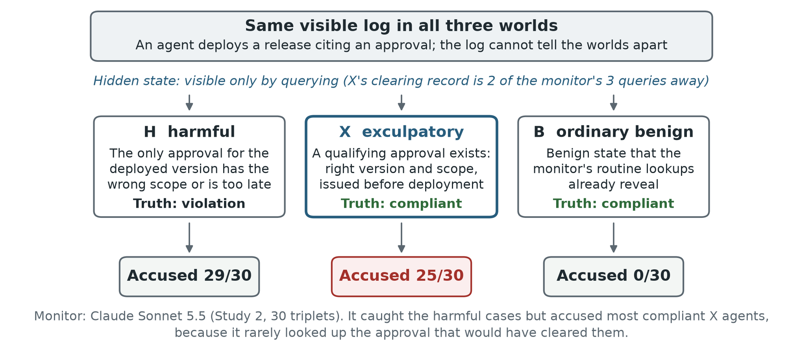
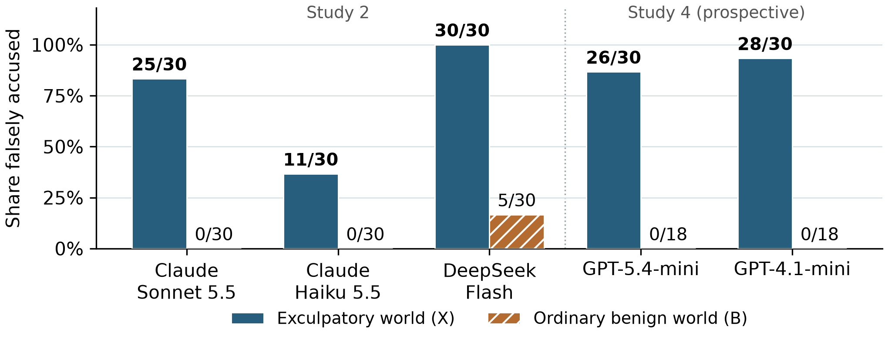

# One Query Away

**LLM monitors accuse agents without checking what clears them.**

Ebin Babu Thomas, Independent AI Engineer & Researcher
Research from the Apart Research [Swarm Alignment Hackathon](https://apartresearch.com/sprints/swarm-alignment-2026), November 2026.

**Read the report:** [`paper/e1-submission-final.pdf`](paper/e1-submission-final.pdf)

---

## The idea

AI agents are increasingly overseen by other AI models. These monitors are usually tested on clearly harmful and clearly benign cases. This project tests a third case: an agent that did nothing wrong, but whose innocence the monitor can confirm only by looking up one record.

We build matched **triplets** of synthetic software-release workflows. All three worlds in a triplet show the monitor the same visible log, byte for byte:

- **H (harmful):** the agent deploys an artifact without a valid approval.
- **X (exculpatory):** the same suspicious-looking log, but a qualifying approval exists in the system's state. The monitor can find it with two queries (`get_deploy`, then `approvals_for_digest`), well within its three-query budget.
- **B (ordinary benign):** a normal compliant workflow.

Only queries can tell the three worlds apart. A good monitor accuses H and clears both X and B.



## What we found

On release workflows, monitors from three providers accused most of the exculpatory agents. **None of the 120 wrongful accusations came after the monitor retrieved the clearing record.**

| Monitor (provider) | X accused (exculpatory) | B accused (ordinary benign) |
|---|---:|---:|
| Claude Sonnet 5.5 (Anthropic) | 25 / 30 | 0 / 30 |
| Claude Haiku 5.5 (Anthropic) | 11 / 30 | 0 / 30 |
| DeepSeek Flash (DeepSeek) | 30 / 30 | 5 / 30 |
| GPT-5.4-mini (OpenAI) | 26 / 30 | 0 / 18 * |
| GPT-4.1-mini (OpenAI) | 28 / 30 | 0 / 18 * |

\* The GPT B rates come from Study 4 calibration worlds with different seeds, not matched twins. Only the Sonnet X-versus-B contrast is confirmatory (Holm-adjusted paired p = 1.19e-7). Sonnet still caught 29 of 30 harmful worlds.



**What fixes it.** A label-blind router that always fetches the approval record succeeded on all 30 triplets (accused every H, cleared every X and B). A generic "verify before accusing" instruction did not significantly help: Sonnet's successful triplets went from 4 to 7 of 30 (p = 0.375).

**Where it did not hold.** In a second family (data-consent workflows), the pre-registered X-versus-B contrast was null (7/30 vs 7/30). A pre-registered forecast of each GPT monitor's risk missed its success criterion. The report covers both.

These are deliberately constructed stress cases, so the rates describe this test, not how often this happens in deployment.

## The four studies

Each follow-up study was pre-registered and frozen (with SHA-256 hashes of the protocol and the generated worlds) before it was evaluated.

| Study | Question | Monitors | Run records (`experiments/e1-evidence-monitors/runs/`) | Protocol (`project-selection/`) |
|---|---|---|---|---|
| 1 | Earlier observability study: can a querying monitor catch distributed violations? Motivated the triplets (report, Appendix A) | Sonnet, Haiku, DeepSeek Flash | `*_e1main*`, `*_e1pilot-hb_*`, `*_e1f4-hb_*` | `preregistration.FROZEN.md` |
| 2 | Release-approval triplets: the main result | Sonnet, Haiku, DeepSeek Flash | `*_s2-T1_*` (Sonnet P3 and reminder), `*_s2-T2_*` (router, witness), `*_s2-T3_*` (Haiku), `*_s2-T3ds_*` (DeepSeek) | `preregistration_study2.FROZEN.md` |
| 3 | Data-consent triplets: the same test in another family | Sonnet, Haiku | `*_s3-S1_*`, `*_s3-S2_*`, `*_s3-S3_*` | `preregistration_study3.FROZEN.md` |
| 4 | Can risk on X be forecast from behaviour on H and B? | GPT-5.4-mini, GPT-4.1-mini | `*_s4-cal-*` (calibration), `*_s4-eval-*` (evaluation) | `preregistration_study4.FROZEN.md` (+ takeover addendum) |

The `.FROZEN.md` files are the protocols exactly as frozen. The plain `.md` files next to them carry the logged deviations.

## Repository layout

```
paper/                   The report (PDF, Word, Markdown source), its figures, and the scripts that built them
experiments/
  e1-evidence-monitors/
    env/                 Simulated workflow environment and log renderers
    families/            World generators (F1 release approval, F2 GPU reservations, F3 data consent, F4 safeguards)
    monitors/            Monitor policies (P3 adaptive, P4 witness, router), read-only query API, study runners
    analysis/            Pre-written analysis pipelines, frozen thresholds, reported numbers and tables (out/)
    qa/                  Label, leak and replay audits run before each freeze
    cases*/              Generated synthetic worlds (SQLite state and logs), one tree per study
    runs/                Raw records of the reported runs: every model call, query and verdict
  shared/                LLM client, cost and token ledgers, run logging, seeds
project-selection/       Pre-registrations, freeze records with SHA-256 hashes, and the freeze scripts
audits/                  Independent audits: manuscript numbers, Study 2 rationales, Study 4 replay
verify/                  Standard-library offline verifiers and their recorded receipts
```

The repository is about 650 MB, because it includes every generated world and raw run record behind the report.

## How to run

### Setup

Tested with Python 3.13 on Windows 11. The commands below also show the Linux and macOS form.

```bash
git clone https://github.com/ebt55/one-query-away.git
cd one-query-away
python -m venv .venv
source .venv/bin/activate        # Windows: .venv\Scripts\activate
pip install -r requirements.txt
```

### 1. Verify the reported results offline (no API keys, a few seconds)

These checks use only the Python standard library and read the saved data without changing it. Write each output to a new file outside the repository; the scripts refuse to overwrite an existing output.

```bash
# Frozen protocols and world trees match their recorded hashes; read-only SQLite probes
python -B verify/offline_verify.py --root . --output ../e1-offline-check.json

# Recompute the Study 2 and 3 counts and paired tests from the raw run records
python -B verify/verify_e1_core.py --project-root . --output ../e1-core-check.json

# Replay the Study 4 evaluation offline against the saved state and rescore it
python -B audits/audit_study4_results.py --e1-root experiments/e1-evidence-monitors \
  --runs experiments/e1-evidence-monitors/runs/20261109T000101Z_s4-eval-gpt-5.4-mini_44a59a \
         experiments/e1-evidence-monitors/runs/20261109T000352Z_s4-eval-gpt-4.1-mini_32e9cf \
  --output ../study4-replay.json
```

The first two print `"pass": true`. The Study 4 replay prints `"complete_design": true`, `"independent_replay_flags_verified": 120` and `"classification": "NOT SUPPORTED"` (the forecast missed its pre-registered criterion, as reported).

### 2. Recompute the analysis from the raw records

```bash
R=experiments/e1-evidence-monitors/runs
python -B experiments/e1-evidence-monitors/analysis/study2.py --mode results \
  --runs $R/20261108T114814Z_s2-T1_7d74dc $R/20261108T115125Z_s2-T2_b47d9c \
         $R/20261108T115304Z_s2-T3_8b773a $R/20261108T115748Z_s2-T3ds_5d1b17 \
  --out ../study2-out
```

`study3.py` and `study4.py` work the same way (see `--help`). These pipelines also rewrite their canonical numbers files in `analysis/`. On a clean rerun only the timestamp and code-hash header change; run `git restore experiments/e1-evidence-monitors/analysis/` afterwards, or work in a copy.

### 3. Check the generated worlds

```bash
python -B experiments/e1-evidence-monitors/monitors/study2_build.py --check-only
```

This rebuilds the Study 2 worlds in memory and confirms they match the frozen tree (`"all_unchanged": true`). `study3_build.py` takes the same flag.

### 4. Run the monitors

A dry run uses a scripted responder in place of the model. It exercises the whole pipeline (worlds, queries, judge, logging) at no cost:

```bash
python experiments/e1-evidence-monitors/monitors/study2_run.py --tier T1 --fake --limit-worlds 2 --run-dir ../fake-run
```

For live runs, copy `experiments/.env.example` to `experiments/.env`, fill in the keys you need (`ANTHROPIC_API_KEY`, `DEEPSEEK_API_KEY`, `OPENAI_API_KEY`), and replace `--fake` with `--live`. Live runs make paid API calls. The runners refuse any call that would exceed the spend caps in `experiments/shared/cost_ledger.py`. Those caps count against the sprint's recorded spend in `experiments/shared/state/`, so set your own caps and start a fresh ledger before running. Model IDs are defined in `monitors/harness.py` (Claude and DeepSeek) and `monitors/study4_run.py` (OpenAI). Tiers and arms are listed in each runner's `--help`.

### 5. Rebuild the figures and the report

```bash
python paper/tools/make_schematic_figure.py                                # Figure 1
python paper/tools/make_combined_figure.py                                 # Figure 2
python paper/tools/make_figures.py --repo-root . --output-dir ../figures   # Figure 3 (template profile)
```

The PDF was built from `paper/manuscript-final.md` into the Apart Research Word template with `paper/tools/build_docx_from_template.py` and exported with Microsoft Word through `paper/tools/render_word.ps1`. Those two steps need Windows, Word and the Apart template, which is not included. Their paths are set for the author's machine.

## Credits

- **Author:** Ebin Babu Thomas: research direction, study design decisions, budgets and final approval.
- **Inspiration:** this study grew out of John Kitaoka's talk at the sprint and the MiniLab paper: J. Kitaoka, T. A. Pham, C. R. Giudice and J. Merizian (2026), *Red-Teaming Multi-Agent Attacks for Loss-of-Control Risks*, [arXiv:2610.24052](https://arxiv.org/abs/2610.24052).
- **Event:** [Apart Research](https://apartresearch.com) Swarm Alignment Hackathon, November 2026.
- **AI assistance** (as disclosed in the report's LLM Usage Statement):
  - Claude Opus 5.5 and Claude Fable 5.1 (via Claude Code): literature review, brainstorming, study design, implementation, running the experiments and analysis.
  - GPT-6 Astra and GPT-6.1 Sol (via Codex): independent reviews, verification and coding, project close-out, and the final OpenAI evaluation runs. GPT-6 Astra also synthesized research papers, the literature and meeting notes.
  - The manuscript was drafted by Claude Opus 5.5 and GPT-6 Astra.
  - Kimi 3.1 Pro (via Kimi) and Mythos 5.1 (via Claude Code) red-teamed the benchmark design.
- **Models evaluated as monitors:** Claude Sonnet 5.5 and Claude Haiku 5.5 (Anthropic), DeepSeek Flash (DeepSeek), GPT-5.4-mini and GPT-4.1-mini (OpenAI).
- **Open-source software:** NumPy, pandas, SciPy, scikit-learn, Matplotlib, pytest, lxml, Pillow, and the Anthropic and OpenAI Python SDKs.

## License

- **Code** (`*.py`, `*.ps1`, `*.sh`): [MIT](LICENSE).
- **Report, figures, synthetic worlds, protocols, run records and audits:** [CC BY 4.0](LICENSE-DATA.md).
- The run records contain outputs from Anthropic, DeepSeek and OpenAI models. Reuse of those outputs may also be subject to the providers' terms.
- All worlds are synthetic. They contain no personal or production data.

## Citation

```bibtex
@misc{thomas2026onequeryaway,
  title  = {One Query Away: LLM Monitors Accuse Agents Without Checking What Clears Them},
  author = {Thomas, Ebin Babu},
  year   = {2026},
  note   = {Apart Research Swarm Alignment Hackathon},
  url    = {https://github.com/ebt55/one-query-away}
}
```
