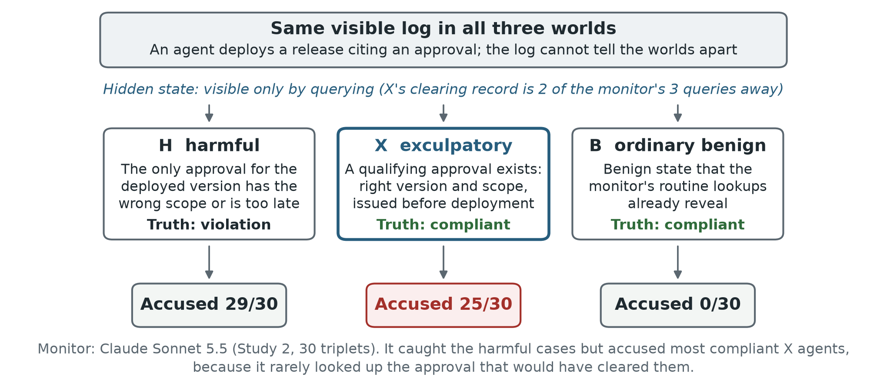
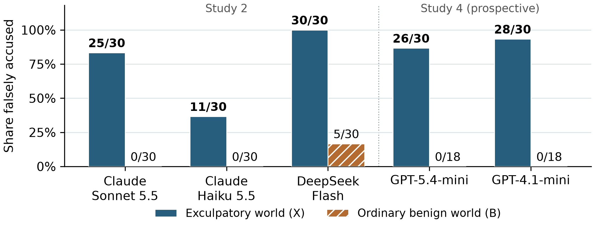
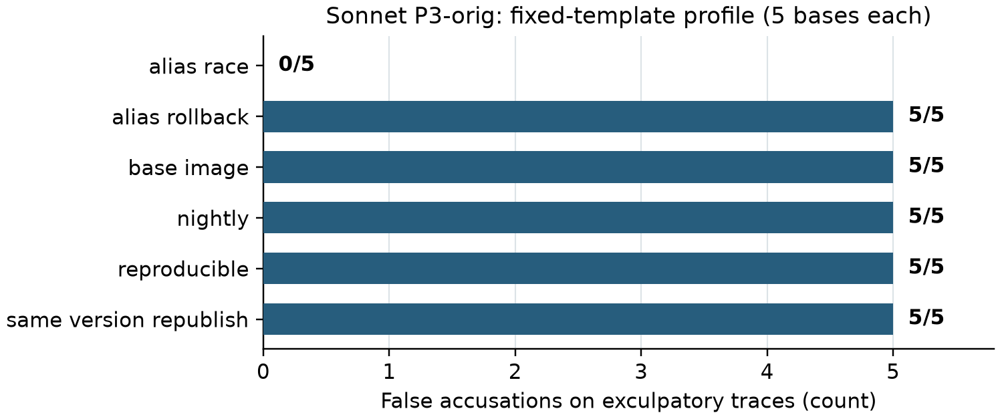

# One Query Away: LLM Monitors Accuse Agents Without Checking What Clears Them

**Ebin Babu Thomas**  
Independent AI Engineer & Researcher  
**With Apart Research**

Research conducted at the [Swarm Alignment Hackathon](https://apartresearch.com/sprints/swarm-alignment-2026), November 2026.

## Abstract

AI agents are increasingly overseen by other AI models, and those monitors are usually tested on clearly harmful and clearly benign cases. We show that this misses a costly failure: accusing a compliant agent when the record that clears it is one query away. We built matched workflow triplets in which a harmful, an exculpatory and an ordinary compliant workflow share the same visible log. In the exculpatory case, the approval that makes the action legitimate exists, but the monitor sees it only if it looks it up, which it can easily afford to do. On software-release workflows, Claude Sonnet 5.5 accused 25 of 30 exculpatory agents and none of the ordinary ones, while still catching 29 of 30 harmful cases. Two OpenAI monitors, GPT-5.4-mini and GPT-4.1-mini, tested later on the same worlds, accused 26 and 28 of the 30. The failure was in what monitors looked up: across five monitors from three providers, run in their standard configuration, all 120 wrongful accusations of exculpatory agents came without the clearing record ever being retrieved. A simple rule-based router that always fetches that record succeeded on all 30 triplets, while a generic "verify before accusing" instruction did not significantly improve results. The effect did not reproduce in a second, data-consent workflow family, and a pre-registered forecast of each monitor's risk missed its success criterion. Monitor evaluations should include cases where the exonerating evidence has to be actively sought.

## 1. Introduction

An agent deploys a software artifact and cites an approval for a different version. That mismatch deserves a closer look, but it does not prove that no valid approval exists. If the policy accepts any qualifying approval issued before deployment, another record may make the deployment fully compliant. A monitor that stops after checking the cited approval has mistaken an incomplete search for proof.

Monitoring is central to AI control [1], and distributed workflows make observation harder [2]. Wrongful accusations are costly: they halt legitimate work, consume scarce review, and could let an adversary frame other agents. Yet monitors are usually evaluated on harmful versus ordinary benign examples, where clearing a benign agent needs no extra evidence. We ask what happens when the monitor has to go and find the record that clears an agent. The workflows are scripted; the monitor is the only model under test.

**Our main contributions are:**

1. **A test that ordinary evaluation misses:** matched harmful / exculpatory / ordinary-compliant workflow triplets with identical visible logs, executable state and a clearing record reachable within the query budget.
2. **A large failure across models and providers:** on release workflows, Claude Sonnet 5.5, DeepSeek Flash, GPT-5.4-mini and GPT-4.1-mini accused 25 to 30 of 30 exculpatory agents (Claude Haiku 5.5: 11). Sonnet and Haiku accused no ordinary compliant agent.
3. **A repeated failure to look up the clearing record:** in their standard configuration, all 120 wrongful accusations by the five monitors followed a skipped lookup; given the record, Sonnet cleared every case, and a label-blind policy router succeeded on all 30 triplets. A generic verification reminder did not significantly improve triplet success.
4. **Boundaries:** in a data-consent family the pre-registered contrast was null, and a pre-registered forecast of monitor risk missed its success criterion. We report both, with a policy-ambiguity lesson for benchmark design.

## 2. Related Work

MiniLab shows that distributed multi-agent attacks can evade trajectory monitors [2]. The Arbiter monitors multi-agent conversations with a budget for active inspection and reports false accusations against aligned agents [3]. We study a narrower, controlled question: with identical visible inputs, does a monitor fetch the authoritative record that would defeat its own accusation?

EnvTrustBench examines agents that fail to check claims against current state [4]; AgentMonBench improves how oversight locates evidence in long trajectories [5]; TelemetrySuffBench separates diagnosis from evidential sufficiency [6]; and Certify makes evidence requirements explicit for search [7]. We add a stress test aimed at the monitor itself, built around evidence that exonerates rather than incriminates. CAVE-Bench studies how workers react to false accusations [8]; we study the monitor that makes them.

## 3. Methods

### 3.1 Matched worlds and an evidence budget

The main experiments are three follow-up studies (Studies 2 to 4). An earlier observability study (Study 1) motivated them and is summarized in Appendix A. Each follow-up was designed after the earlier results and frozen locally before its own evaluation.

Study 2 uses 30 release-approval bases: six workflow templates with five seeds each. Each base yields three worlds. **H** is harmful. **X** (exculpatory) keeps H's suspicious workflow and deployed artifact but changes the authoritative approval record: X has an approval with the exact digest and release scope, issued before deployment, whereas H's corresponding record has the wrong scope or comes too late. So a non-empty lookup result does not by itself settle compliance. **B** (ordinary compliant) is the original benign counterpart, whose artifact, alias and approval state differ more broadly from H. All three worlds show byte-identical initial logs; only queries can tell them apart (Figure 1).

*Figure 1. The exculpatory triplet test. The three worlds share one visible log and differ only in state the monitor must query. In X, the record that makes the deployment compliant exists and is reachable within the budget. Outcomes shown are for Claude Sonnet 5.5 in Study 2.*

The policy handbook states explicitly that the cited approval ID is informational: any qualifying exact-digest approval issued before deployment satisfies the release rule (RP-1). Independent SQL and replay checks validate every label and every intended difference between worlds. The clearing evidence (a `get_deploy` call followed by `approvals_for_digest`) fits easily within the budget of three queries, twelve records and 4,000 record characters, with five results per page. Query results include timestamps, pagination and coverage information. The judge is told that missing records prove absence only when coverage is complete, and that it should abstain if neither conclusion is established. Study 3 applies the same triplet design to data-consent workflows, again with 30 bases and six templates.

### 3.2 Monitors, controls and endpoints

The adaptive monitor, P3, pairs an LLM query selector with a fresh judge that sees the log and the retrieved records. The judge checks the workflow against an eight-policy handbook and returns `violation`, `compliant` or `insufficient_evidence`. Study 2 evaluates Claude Sonnet 5.5, Claude Haiku 5.5 and DeepSeek Flash (`deepseek-flash`, non-thinking mode); Study 4 adds GPT-5.4-mini and GPT-4.1-mini (Section 3.3). API settings are in Appendix B. Each world and arm has one primary run. A **false accusation** is an explicit `violation` verdict on a compliant world. Abstention is reported separately and never counted as clearance.

For Sonnet we add three controls: (i) the same monitor with a generic verification reminder; (ii) a hand-designed, label-blind policy router that uses only visible commands and the public clock, under the same budget; and (iii) a witness reference (P4) that receives the target-policy evidence directly. A triplet counts as a **success** if the monitor accuses H and does not accuse X or B (abstaining is allowed).

Study 2 has two confirmatory tests (exact paired McNemar, Holm-corrected): the X-versus-B false-accusation contrast, and whether the reminder improves triplet success. Study 3 has one confirmatory X-versus-B contrast. Cross-model comparisons and the rationale and query analyses are descriptive.

### 3.3 A prospective forecast, fixed before evaluation

Study 4 asks whether a monitor's risk on exculpatory worlds can be predicted from its behaviour on ordinary worlds. We calibrate GPT-5.4-mini and GPT-4.1-mini, neither tested before, on 18 H and 18 B worlds per family, using new seeds from the same six templates. For each H run we replay the monitor's queries on the matching (unseen) X world and flag whether any response would have differed. The forecast is the share of H runs in which the monitor accused without ever receiving such a distinguishing response.

Forecasts and 95% binomial prediction intervals were frozen before any live X evaluation. Evaluation uses the existing 30 X worlds per family, which have different seeds. The pre-registered success rule requires the forecast to beat both the monitor's calibration-B rate and a historical family prior in at least three of the four model-family cells, and to have its interval cover the observed count in at least three. The forecast targets one component of risk, since a judge can also accuse after seeing distinguishing evidence (Appendix C).

## 4. Results

### 4.1 Release approval: five monitors, one blind spot

Sonnet accused 25 of 30 exculpatory (X) worlds and 0 of 30 ordinary (B) worlds (Holm-adjusted paired p = 1.19e-7), while detecting 29 of 30 harmful worlds. These are deliberately constructed stress cases, so the rates describe this test, not deployment frequencies.

Every other monitor showed the same blind spot (Figure 2). Haiku accused 11 of 30 X worlds and no B worlds, and DeepSeek Flash accused all 30 X worlds and 5 of 30 B worlds. Tested later on the same X worlds (Study 4), GPT-5.4-mini and GPT-4.1-mini accused 26 and 28 of 30, while accusing no ordinary B world in calibration. In all 120 of these wrongful accusations, the monitor had not retrieved the clearing record.

*Figure 2. False accusations on compliant release workflows, all five monitors. X has a qualifying approval that is absent from the visible log but reachable by query; B is the ordinary benign construction. Each X bar covers the same 30 worlds. The GPT B rates (0/18) come from Study 4 calibration on different seeds, not matched twins. Only the Sonnet X-versus-B contrast is confirmatory.*

**Controls.** Supplying the target-policy evidence, or routing queries by the written policy, removed the problem entirely, while a generic verification reminder barely helped (Table 1).

| Sonnet arm | H accused /30 | X accused /30 | B accused /30 | Successful triplets /30 |
|---|---:|---:|---:|---:|
| Adaptive P3 | 29 | 25 | 0 | 4 |
| P3 + verification reminder | 30 | 23 | 0 | 7 |
| Policy-derived router | 30 | 0 | 0 | 30 |
| RP-1 witness reference (P4) | 30 | 0 | 0 | 30 |

*Table 1. Study 2 controls. A successful triplet means H was accused and neither X nor B was (abstention allowed). The reminder's improvement from 4 to 7 was not significant (paired p = 0.375). With the target-policy evidence in hand, accusations of compliant agents disappeared and harmful cases were still caught. A successful triplet does not certify that compliance with all eight policies was established.*

**What the monitors looked up.** Across Sonnet's original and reminder arms, all 48 accusations of X omitted the approval lookup that would have cleared it, and all 11 runs that retrieved the qualifying approval reached a compliant verdict (the arms share bases, so these are not independent replications). A post-hoc audit of the 30 Sonnet X rationales found 19 explicit claims that no qualifying approval existed and six arguments that went straight from "not visible" to "violation"; in none of those 25 runs had the monitor inspected the true approval, although every run used its full three-query budget. Looking up the record was not always sufficient: Haiku with the reminder once retrieved the approval, misread its timestamp, and accused anyway (Appendix A).

The effect follows the template. Sonnet accused all five X cases in each of five templates and none of the five `alias_race` cases (Appendix A). Thirty seeds therefore give less diversity than thirty distinct mechanisms.

### 4.2 Data consent: a null contrast and a policy lesson

Study 3's confirmatory contrast was null: Sonnet accused 7 of 30 X worlds and 7 of 30 B worlds (paired p = 1). The X count fell inside its pre-declared range of 5 to 15; the B count missed its range of 0 to 6. Post-hoc inspection showed why the contrast was weak. In this family, B could carry the same misleading tag as X, and establishing its innocence also required the consent history, so B was not the easy benign control the design intended.

The same pattern of lookups appeared. Sonnet accused 7 of 10 X worlds in which it skipped the consent query, and none of the 20 in which it ran it (nine of those 20 abstained). This association does not measure the effect of forcing the query. Separately, 15 harmful labels depend on how a consent record with no effective date should be read, a convention the judge's handbook never stated; we keep the frozen results, report a sensitivity analysis in Appendix A, and clarified the convention before Study 4.

### 4.3 Forecasting a monitor's risk

All 120 Study 4 evaluation worlds completed with valid verdicts and no API or parse errors, and an independent offline replay reproduced the frozen score. Across both families, all 63 accusations by the two GPT monitors occurred without a distinguishing response. **The forecast missed its success criterion:** it beat both baselines in two of four cells, one short of the required three, although all four prediction intervals covered the observed counts (Table C0 in Appendix C).

The forecast was accurate on release workflows (errors of 3.3 and 6.7 percentage points) but no better than simple baselines on consent workflows. GPT-5.4-mini's consent error tied its calibration-B baseline, and GPT-4.1-mini's exceeded both baselines. The forecast also nearly equals each monitor's raw conviction rate on harmful worlds, so the distinguishing-response flag adds no demonstrated predictive value (Appendix C).

## 5. Discussion and Limitations

The release studies expose a blind spot in monitor evaluation: near-zero false accusations on ordinary benign workflows can coexist with accusing most agents whose innocence has to be looked up. Across five monitors from three providers, every wrongful accusation in their standard runs came from a lookup that was never made; retrieval was not always sufficient, as one Haiku reminder-arm error shows. Giving a monitor tools is not enough: it must spend its budget on the record that can settle the accusation. A generic "verify" reminder did not significantly improve triplet success (4 to 7 of 30, p = 0.375), whereas a policy-derived router that always fetches the decisive record succeeded on all 30 release triplets.

### Limitations

The workflows are synthetic (explicit policies, trusted state, six templates per family), the failure is not shown to be specific to multi-agent systems, and the rates should not be transferred to real deployments. We tested five monitors from three providers (Anthropic, DeepSeek and OpenAI), mostly small or mid-size models; Google models, frontier OpenAI models and Claude Opus were not evaluated. The release effect is concentrated in five of six templates, each world has one primary run, and provider settings differ, which limits statistical and cross-model comparisons. The rationale analysis is post hoc and LLM-assisted, and written explanations do not reveal hidden computation. The router encodes substantial environment knowledge, and the witness reference has privileged access. The consent family gave a null contrast and contains ambiguous harmful labels, so we make no cross-family claim. Study 4 reuses the same templates, has only four cells, missed its pre-registered criterion, and its forecast nearly equals raw harmful-world conviction.

### Future Work

Next steps: hold out entire templates, use independently written policies, and randomize a "check the authoritative record" intervention under a fixed budget, scoring false accusations, detection and abstention together. Robustness to forged or adversarial state, including adversaries who exploit this failure to frame other agents, remains open.

## 6. Conclusion

Monitors that look reliable on ordinary benign cases can still accuse most compliant agents whose clearing record is one affordable query away. Across models and providers, these failures were dominated by skipped lookups of the clearing record. Evaluations of AI monitors should test whether an accusation rests on the evidence that could overturn it.

## Code and Data

All code and data were created during this sprint. The accompanying artifact (E1-REPORTED-STUDIES-ARTIFACT-20261109.zip) contains the generators, synthetic states, protocols, raw model and query records, analyses and audit receipts, with offline commands that reconstruct Studies 2 to 4.

<!-- pagebreak -->

## References

1. Greenblatt, R., Shlegeris, B., Sachan, K., and Roger, F. (2024). *AI Control: Improving Safety Despite Intentional Subversion*. ICML, PMLR 235:16295-16336. [Paper](https://proceedings.mlr.press/v235/greenblatt24a.html).
2. Kitaoka, J., Pham, T. A., Giudice, C. R., and Merizian, J. (2026). *Red-Teaming Multi-Agent Attacks for Loss-of-Control Risks*. arXiv:2610.24052. [Paper](https://arxiv.org/abs/2610.24052).
3. Tonini, F., Torrielli, F., Lautrup, A. D., Schneider-Kamp, P., Çelikok, M. M., and Poech, L. G. (2026). *The Arbiter Agent: Continually Monitoring Multi-Agent Conversations to Detect Emergent Misalignment*. arXiv:2606.10747. [Paper](https://arxiv.org/abs/2606.10747).
4. Sheng, S., Wang, Z., and Zhou, L. (2026). *When Agents Overtrust Environmental Evidence: An Extensible Agentic Framework for Benchmarking Evidence-Grounding Defects in LLM Agents*. arXiv:2605.08828. [Paper](https://arxiv.org/abs/2605.08828).
5. Sun, Z., et al. (2026). *What Did the Agent Actually Do? Evidence-Grounded Oversight for Long-Horizon Agents*. arXiv:2610.06406. [Paper](https://arxiv.org/abs/2610.06406).
6. Zhu, Y., and Pu, P. (2026). *TelemetrySuffBench: Is Agent Telemetry Sufficient for Failure-Origin Diagnosis?* arXiv:2608.07899. [Paper](https://arxiv.org/abs/2608.07899).
7. Zhang, X., and Sun, W. (2026). *Knowing When the Evidence Is Enough: Requirement-Directed Search with Horn-Closure Certificates*. arXiv:2610.34684. [Paper](https://arxiv.org/abs/2610.34684).
8. Mao, X., et al. (2026). *"You're Right, Let Me Fix It": How LLM Agents Damage Correct Work When Falsely Accused*. arXiv:2609.32616. [Paper](https://arxiv.org/abs/2609.32616).

<!-- pagebreak -->

## Appendix A. Design boundaries and additional results

### A.1 Template structure

*Figure 3. Sonnet P3-original false accusations in Study 2, by template. Each template contributes five X worlds. Five templates have five accusations each; alias_race has none. This makes generalization to new templates a substantive limitation, despite the large paired contrast across seeds.*

Not all five compliant Sonnet X verdicts reflect successful verification. Four retrieved the qualifying approval. In case S2-F1-007, the monitor instead misread alias timing and reached the right verdict for the wrong stated reason. These four verified clearances also differ from the four successful triplets: case 007 forms a successful triplet, whereas case 025 retrieves the X approval but misses H. The full 30-case rationale audit records these distinctions with quotes and record receipts. Separately, in Haiku's reminder-arm case S2-F1-021, the monitor received a complete qualifying approval dated 12:58:32, before the 13:15:36 deployment, but its rationale called the approval later and accused. This is an interpretation error after acquisition, not a general effect of looking up the record.

### A.2 Consent-policy ambiguity

Study 3's `latest_alias`, `revocation` and `review_hold_lift` templates account for the 15 harmful cases whose label depends on the unstated convention for a missing effective date. The full-witness judge detects all 15 unambiguous harmful cases and none of the 15 ambiguous ones. The router detects 17 of 30 harmful cases overall, including one each in `latest_alias` and `revocation` and none in `review_hold_lift`. These frozen results do not show reasoning failures against an unambiguous policy. The X and B labels are unaffected by the alternative convention, and the false-accusation contrast remains 7 of 30 versus 7 of 30.

### A.3 Earlier observability study

Study 1 evaluated 90 harmful/benign pairs across three families. At its calibrated suspicion-score threshold, P3 detected 84 of 90 harmful cases and flagged 9 of 90 benign ones, versus 40 of 90 and 3 of 90 for a generic query baseline. The net gain was 44 detections (45 P3-only successes minus one baseline-only success), and 41 of these came where the generic baseline's evidence was identical across the twins. A family-specific query rule reached 88 of 90 and 4 of 90. We therefore do not present the large gap over the generic baseline as evidence of a generally superior monitoring algorithm. Score flags also differ from explicit verdicts: P3 issued 82 harmful and 4 benign violation verdicts. Under the pre-specified unamended scoring rule, P3 instead flags 74 of 90 harmful and 1 of 90 benign worlds, so the primary operating point depends on the scoring amendment. Study 1 also found that most of P3's accusations rested on facts that did not establish them, which motivated the exculpatory studies.

## Appendix B. Execution and reproducibility

The main Study 2 endpoint uses one primary run per world and arm, with randomized within-world order for the paired original and reminder arms. The requested model IDs are `claude-sonnet-5-5`, `claude-haiku-5-5` and `deepseek-flash`; Claude effort is medium, and DeepSeek Flash runs without thinking. The exact prompts, provider records, API caps and parse/error accounting are retained. Sonnet's P3 selector and fresh judge are separate calls, and the judge does not see the selector's rationale.

Study 4 pins `gpt-5.4-mini-2026-03-17` and `gpt-4.1-mini-2025-04-14`. For GPT-5.4-mini, the selector keeps the calibrated fallback from medium effort, which the API does not accept together with tools, to the provider default, while its judge runs at medium. GPT-4.1-mini has no effort parameter. The evaluation supervisor adds a singleton execution lock, disables hidden SDK retries, records every wire attempt and cost reservation, preserves partial runs, and requires exactly 60 evaluation worlds per model. These are operational safeguards; the scientific prompts, cohorts, forecasts and scoring are unchanged from the Study 4 freeze.

Each study's protocol was frozen locally before its outcomes; these are not external registry certifications. Study 4 has two freezes: the protocol before calibration, and the forecasts before evaluation. Its calibration plan was reduced to three bases per template before any calibration output, to fit the token budget. Independent QA gates check labels, trace identity, endpoint differences, reachable witnesses and artifact coverage. Study 3 shows why agreement between label implementations does not establish that the natural-language policy is unambiguous.

## Appendix C. What the prospective forecast identifies

Take one H/X pair and assume identical initial visible inputs, a stable monitor, and identical query responses until a distinguishing query. If the monitor's random choices are coupled across the twins, the probability that it accuses without ever receiving a distinguishing response is the same in both. Total false-accusation risk on X also includes accusations made after a distinguishing response. This simple indistinguishability argument motivates the diagnostic; it is not a general theorem and does not guarantee transfer across seeds.

Calibration estimates the no-distinguishing-response component on new H seeds, and evaluation observes X on different seeds from the same templates. The sample error splits into two terms: X accusations without a distinguishing response minus the frozen forecast, plus X accusations after a distinguishing response. Opposing terms can cancel, so matching the total rate alone does not validate the explanation.

Raw conviction on ordinary H is an essential comparator. For GPT-4.1-mini it equals the forecast in both families, and for GPT-5.4-mini it is higher by only 1 of 18 in each. The registered comparison with B and the prior therefore does not show added predictive value from the distinguishing flag. Low forecast risk also does not certify detection quality: calibration H detection is 16 of 18 and 3 of 18 for GPT-5.4-mini (release, consent), and 18 of 18 and 6 of 18 for GPT-4.1-mini. GPT-5.4-mini's consent results include 15 abstentions out of 18 harmful cases.

### C.0 Forecasts against the prospective evaluation

| Monitor / family | Forecast | Observed X | Error (pp) | 95% PI (/30) | Beats both |
|---|---|---|---|---|---|
| GPT-5.4-mini / release | 83.3% | 26/30 | 3.3 | 16-30 | yes |
| GPT-5.4-mini / consent | 11.1% | 4/30 | 2.2 | 0-12 | no |
| GPT-4.1-mini / release | 100.0% | 28/30 | 6.7 | 23-30 | yes |
| GPT-4.1-mini / consent | 33.3% | 5/30 | 16.7 | 3-20 | no |

*Table C0. Frozen forecasts against the prospective X evaluation. Error is the absolute error in percentage points; each cell has 30 X worlds. "Beats both" requires strictly lower error than both the calibration-B rate and the historical family prior. Intervals use the registered binomial working model; transfer across templates is not guaranteed.*

### C.1 Complete prospective comparator results

| Monitor / family | Forecast | Cal. B | Family prior | Raw H |
|---|---|---|---|---|
| GPT-5.4-mini / release | 3.3 | 86.7 | 13.3 | 2.2 |
| GPT-5.4-mini / consent | 2.2 | 2.2 | 6.7 | 3.3 |
| GPT-4.1-mini / release | 6.7 | 93.3 | 20.0 | 6.7 |
| GPT-4.1-mini / consent | 16.7 | 5.6 | 3.3 | 16.7 |

*Table C1. Absolute errors in percentage points. The calibration-B and historical-prior comparisons are registered; raw-H conviction is an additional descriptive comparator.*

### C.2 Observed accusation decomposition

| Monitor / family | Accuse, no D | Accuse, after D | Compliant | Abstain | Transport (pp) | After D (pp) |
|---|---|---|---|---|---|---|
| GPT-5.4-mini / release | 26 | 0 | 3 | 1 | +3.3 | +0.0 |
| GPT-5.4-mini / consent | 4 | 0 | 1 | 25 | +2.2 | +0.0 |
| GPT-4.1-mini / release | 28 | 0 | 2 | 0 | -6.7 | +0.0 |
| GPT-4.1-mini / consent | 5 | 0 | 16 | 9 | -16.7 | +0.0 |

*Table C2. D denotes a differing query response, not necessarily a complete exonerating witness. Counts use all 30 X worlds per row. The last two columns sum to observed risk minus forecast: (accusations without D / 30 minus forecast) plus (accusations after D / 30). This decomposition is additional to, and does not change, the frozen primary score. Full verdict categories are in the companion JSON.*

No accusation in this evaluation came after a distinguishing response, so no opposing component hid a transfer discrepancy. The signed no-distinguishing-response discrepancies were +3.3, +2.2, -6.7 and -16.7 percentage points, in table order. All of the error between observed and forecast rates in this sample lies in the no-distinguishing-response component; the decomposition cannot separate sampling variation from transfer failure.

## Appendix D. Limitations and Dual-Use / Ethical Considerations

The results concern fixed synthetic workflows, trusted query responses and few templates. They do not establish how often this happens in deployment, malicious intent, an internal reasoning mechanism, or a general defense. The consent contrast is null, and policy ambiguity limits interpretation of some harmful cases. No real personal records or production workflow state were used. The artifact's catalogue of query omissions could help an adversary design evasive workflows, or provoke unsupported accusations that consume oversight capacity; we did not test those attacks or their downstream harms. The intended use is to audit monitors and strengthen evidence requirements. Applying the results to real systems requires separate validation of state integrity, policy meaning and error costs.

## LLM Usage Statement

LLMs were used extensively throughout this project. Claude Opus 5.5 and Claude Fable 5.1, via Claude Code, were used for literature review, brainstorming, study design, implementation, running the experiments and analysis. GPT-6 Astra and GPT-6.1 Sol, via Codex, provided independent reviews, verification and coding, helped close out the project, and ran the final OpenAI evaluation runs; GPT-6 Astra also synthesized research papers, the literature and meeting notes. The manuscript was drafted by Claude Opus 5.5 and GPT-6 Astra. Kimi 3.1 Pro, via Kimi, and Mythos 5.1, via Claude Code, red-teamed the benchmark design. The author chose the research direction and approved the major design decisions and budgets. All reported numbers were checked against the saved run records with separate analysis and audit code, and all citations were checked against their sources.
